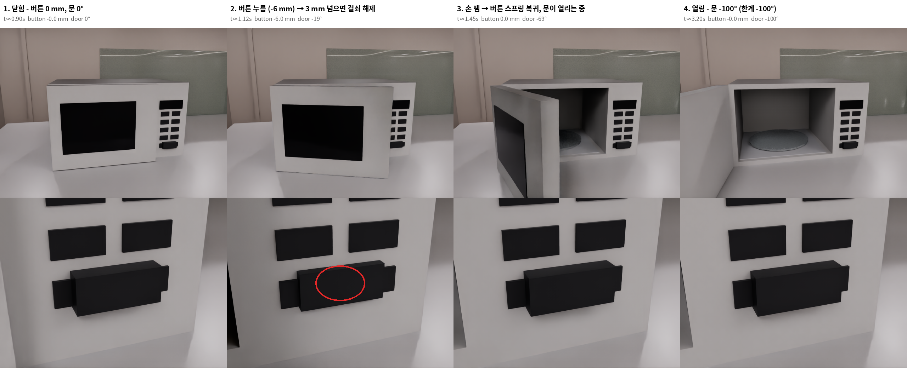

# 전자레인지 버튼 동작 (`assets/Microwave/Microwave.usda`)

실물(winia NKRL201EWW)은 조작부 오른쪽 아래 버튼을 누르면 걸쇠가 풀려 문이 열립니다. USD에서는 이 동작을 **관절 2개 + 걸쇠 규칙 1개**로 나눠 만들었습니다.



`validation/microwave_button_demo.png`: 실제 GPU 물리 시뮬레이션에서 찍은 4단계입니다. 위는 정면, 아래는 버튼 확대이고, 2단계의 빨간 원이 버튼입니다.

## 구조

| 관절(DOF) | 종류 | 범위 | 구동 | 의미 |
|---|---|---|---|---|
| `door` | revolute (Z축, 정면에서 볼 때 **왼쪽** 앞 모서리 경첩) | 0 ~ −100° (음수 = 열림) | 감쇠 0.5만 있고 스프링 없음 | 문. 연 만큼 그 자리에 머뭅니다 |
| `button` | prismatic (몸체 안쪽 방향) | 0 ~ −6 mm | 스프링 3000 N/m, 감쇠 20 | 누르면 들어가고, 손을 떼면 0 mm로 돌아옵니다 |

**걸쇠 규칙:** 물리로 표현하지 않고, 에셋 루트의 `customData.latch`에 값을 둡니다.

| 키 | 값 | 뜻 |
|---|---|---|
| `press_to_open_m` | 0.003 | 버튼이 3 mm 넘게 눌리면 걸쇠가 풀립니다 |
| `door_open_sign` | −1 | 문이 열리는 방향(음수) |
| `button_joint` / `door_joint` | `Joints/button` / `Joints/door` | 관절 경로 |

## 동작 순서와 실측값

`scripts/25_microwave_button_demo.py`, 120 Hz GPU 물리 기준입니다.

| 시각 | 상태 | 버튼 | 문 |
|---|---|---|---|
| 0.90 s | 닫힘 | 0 mm | 0° |
| 1.00 s | 손가락이 버튼을 누르기 시작(목표 −6 mm) | → | |
| **1.017 s** | 버튼이 −3 mm를 넘음 → **걸쇠 해제**, 컨트롤러가 문을 열기 시작 | −3 mm | 0° |
| 1.12 s | 끝까지 눌림 | −6.0 mm | −19° |
| 1.30 s | 손을 뗌 → 스프링이 버튼을 되돌림 | | |
| 1.45 s | 문이 열리는 중 | 0.0 mm | −69° |
| 3.20 s | 완전히 열림(한계각) | 0.0 mm | −100° |

시간별 값은 `validation/microwave_button_timeseries.csv`에 있습니다(열: t_s, finger_pressing, button_mm, door_deg, latch_released). 요약은 `validation/microwave_button_demo.json`에 있습니다.

## 로봇 학습에서 쓰는 방법 (Isaac Lab)

로봇 손가락이 버튼을 밀면 `button` 관절이 실제로 들어갑니다. 아래 규칙을 매 스텝 실행하면 실물처럼 문이 열립니다.

```python
import torch
mw = scene["microwave"]                                   # ArticulationCfg로 불러온 Microwave
bid, did = mw.find_joints("button")[0][0], mw.find_joints("door")[0][0]
q = mw.data.joint_pos.torch                               # (num_envs, num_dofs)
release = (q[:, bid] < -0.003) & (q[:, did] > -0.05)      # 3 mm 넘게 눌림 + 문이 닫혀 있음
envs = release.nonzero().flatten()
if len(envs):                                             # 열림 방향(음수)으로 구동, 한계 -100°에서 멈춤
    mw.actuators.target_command.set_velocity_index(value=torch.full((len(envs), 1), -2.5, device=q.device),
                                                   joint_ids=[did], env_ids=envs)
```

위 코드는 Isaac Lab 17 API(`set_joint_velocity_target`는 deprecated) 기준으로 작성했습니다. 그림과 표의 시뮬레이션은 같은 규칙을 Isaac Sim API로 실행한 결과이고, 이 Isaac Lab 코드 자체는 아직 실행해 보지 않았습니다.

- 문을 손으로 닫으려면 속도 목표를 0으로 되돌리면 됩니다. 문에는 스프링이 없어 닫힌 자리에 머뭅니다.
- 실물처럼 "닫혀 있는 동안은 손으로 당겨도 안 열리게" 하려면, 걸쇠가 풀리기 전까지 문 관절에 위치 목표 0과 강성을 주면 됩니다. 지금은 문 손잡이가 없어 당기는 조작은 고려하지 않았습니다.

## 바꾸는 곳

`config/add_obj_v1_furniture.json` → `assets.Microwave.button`에서 바꿉니다.

| 키 | 뜻 |
|---|---|
| `travel` | 버튼 이동 거리 |
| `stiffness` | 복귀 스프링 강성 |
| `press_to_open_m` | 걸쇠가 풀리는 눌림 깊이 |

`open_deg`는 문이 열리는 한계각입니다. 바꾼 뒤 `python 20_furniture_assets.py`(ASSETS=Microwave) → `21` → `25`를 다시 실행하면 그림과 표가 갱신됩니다.
