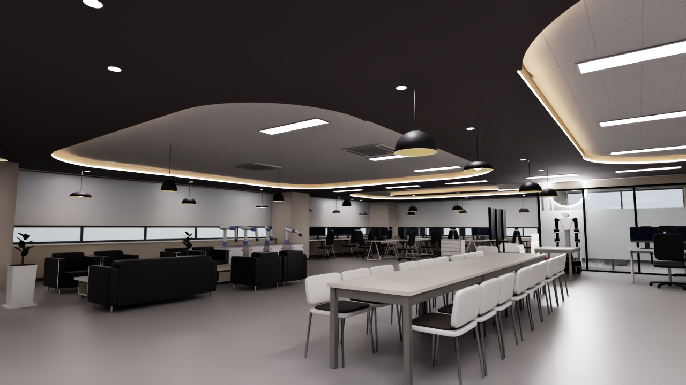

# DX Hub v1 배치 (브랜치 `Dx_hub_v1`)

FJD 2D 장비로 스캔(2026-10-30, 2026-11-02)해 측정한 실제 가구·로봇 배치를 DX Hub 디지털 트윈 USD에 반영한 브랜치입니다.

`main`의 `DX_Hub_Building_add_obj_v1`을 기반으로 만들었고, 같은 내용을 [kangkwonlee/Dx_hub_project](https://github.com/kangkwonlee/Dx_hub_project)에서도 볼 수 있습니다. 작업 과정에서 Claude를 참고했습니다.



## 추가한 파일

```
DX/USD/
├── DX_Hub_Building_add_obj_v1_layout_20261102/
│   ├── DX_Hub_Building_add_obj_v1_layout_20261102.usda   # 배치 레이어
│   ├── view.usda                                         # 조명과 확인용 카메라를 더한 스테이지
│   └── validation/                                       # 모델만 렌더링한 이미지
├── config/dx_hub_v1/    # 측정 결과와 배치 입력 JSON
└── scripts/dx_hub_v1/   # 배치, 모델 생성, 측정, 지도 생성 코드
    └── exploratory/     # 중간 시도
```

`main`에 있던 파일은 수정하지 않았습니다. 이 레이어는 `DX_Hub_Building_add_obj_v1`을 서브레이어로 불러오고, 달라진 부분만 덮어씁니다.

- **옮긴 가구:** 위치와 방향만 덮어씁니다.
- **추가한 가구:** `Furniture/Hall/Scan_*` 아래에 정의합니다.

## 사용 방법

SG2 모델은 [ROBOTIS-GIT/cyclo_lab](https://github.com/ROBOTIS-GIT/cyclo_lab)의 `FFW_SG2.usd`를 상대 경로로 참조합니다. 이 저장소와 같은 폴더에 받아야 합니다.

```bash
git clone -b Dx_hub_v1 https://github.com/cailab-hy/P2-DX_project.git
```

```bash
git clone https://github.com/ROBOTIS-GIT/cyclo_lab.git
```

Isaac Sim에서 `DX/USD/DX_Hub_Building_add_obj_v1_layout_20261102/view.usda`를 열면 됩니다. 확인에 쓴 환경은 Isaac Sim 6.2 / Isaac Lab 3.0(aarch64)입니다.

## 배치 다시 만들기

대상 파일이 이미 있으면 먼저 지워야 합니다. 경로는 절대 경로로 지정합니다.

```bash
cd DX/USD/scripts/dx_hub_v1
```

```bash
python place_final.py ../../config/dx_hub_v1 ../../config/dx_hub_v1 "$PWD/../../DX_Hub_Building_add_obj_v1/DX_Hub_Building_add_obj_v1.usda" "$PWD/../../DX_Hub_Building_add_obj_v1_layout_20261102/DX_Hub_Building_add_obj_v1_layout_20261102.usda"
```

`cyclo_lab`이 `~/Isaac/cyclo_lab`이 아닌 곳에 있으면 환경 변수 `CYCLO_LAB`으로 경로를 지정합니다.

## 추가한 항목

| 항목 | 수량 | 코드 |
|---|---|---|
| ROBOTIS AI Worker SG2 (관절을 끈 고정 모델) | 1 | `place_final.py` |
| BRS120M | 4 | `brs120m.py` |
| LG CLOi | 4 | `cloi.py` |
| 마음AI 에이든 | 3 | `maumai.py` |
| RBM-S100a | 2 | `rbm_s100a.py` |
| RB-Y1 | 1 | `rby1.py` |
| 서랍장 | 2 | `drawer_chest.py` |
| 둥근 테이블 / 원형 스툴 | 1 / 7 | `round_items.py` |
| 화분(몬스테라) / 꽃 화분 | 4 / 1 | `monstera.py` |
| 벽걸이 TV (스캔 기준 2.53×1.44 m) | 1 | `wall_tv.py` |
| 펜던트 조명 | 27 | `pendant_lamps.py` |
| 모니터 | 31 | `monitors.py` |
| 소화기, 사무용 책상·의자 등 기존 모델 | - | `place_final.py` |

기존 가구 26개는 스캔에 맞춰 옮겼습니다.

## 측정 방법

1. 스캔을 건물 모델에 정합합니다(`register_scan.py`). 건물과의 오차는 3.0 cm, 두 스캔 사이 오차는 2.1 cm입니다.
2. 두 스캔을 합치고 비교합니다(`compare_scans.py`).
3. 높이별 단면과 외곽선 피팅으로 위치, 방향, 크기를 측정합니다.

## 한계

- 제품 모델은 제조사 CAD가 아닙니다. 크기는 스캔이나 제품 사양에서, 모양은 제품 사진을 보고 단순화해 만들었습니다.
- 스캔으로 앞뒤를 알 수 없는 물체의 방향은 추정값입니다. 일부 모니터의 수와 방향도 여기에 해당합니다.
- 충돌 형상은 모델별로 넣었고, 짧은 물리 시뮬레이션으로 일부만 확인했습니다. GPU 물리에서는 일부 볼록 메시가 변형체(티셔츠)와 충돌하지 못한다는 경고가 18건 나옵니다.

## 포함하지 않은 것

원본 스캔(`.las`, `.fjdata`)과 합친 점 데이터는 올리지 않았습니다. `config/dx_hub_v1/`의 측정 결과로 배치는 다시 만들 수 있지만, 측정 코드(`register_scan.py`, `compare_scans.py`, 각 모델 코드의 `measure`)는 이 브랜치만으로는 실행되지 않습니다.
